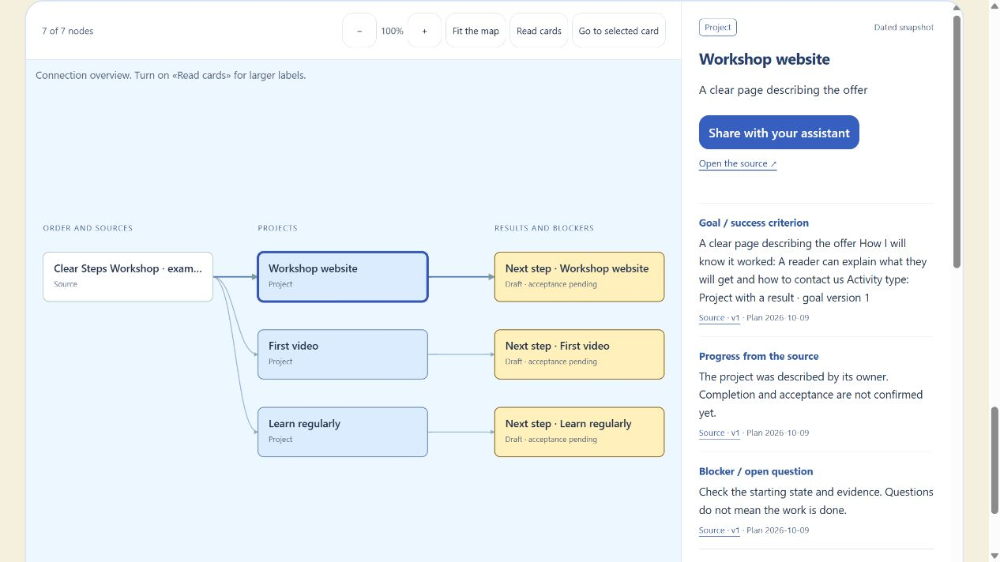
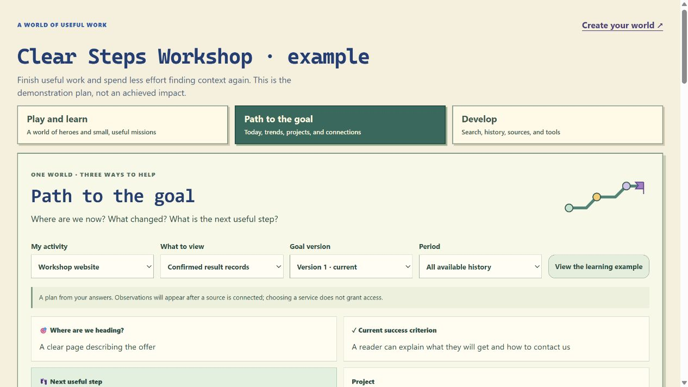
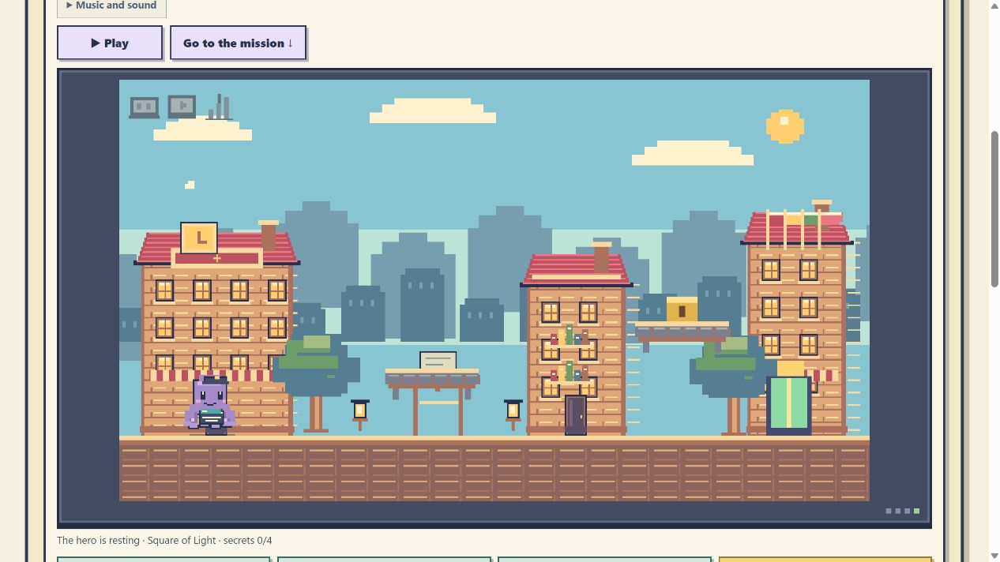

# City of Light

**Turn project chaos into one clear next step.**

English is the public default. [Read and use it in your language](#use-your-language).

**[Download the latest checked Pro preview](https://github.com/kamenotes88/city-of-light/releases/latest)** · [Set up with your AI assistant](#start-with-one-useful-result).

[](https://github.com/kamenotes88/city-of-light/actions/workflows/check-preview.yml)

A local project world for people who work with Codex or Claude Code. Keep
one goal, a way to check success, and the next useful step. Return later with
your saved context instead of starting the same conversation again.

Your work has one shared state with a relationship map, a progress timeline,
and an optional game city. The full Pro interface adds plans, human decisions,
working-chat role links, tools and settings. City of Light uses the Project World engine.
The free core works without registration or a paid subscription.

With the optional local runner, one launcher opens your world, selected-chat
history and the supported Codex connection. Ask AI for a plan, review and edit
its stages, approve it separately, then explicitly start one agreed step. The
worker's report returns to your city as pending evidence. A confirmed complete
stage adds a floor; a short completed task becomes a city object. Repeated
messages and game play do not manufacture project achievements.

Selected local files update through one foreground event connection, without
model calls. Closing and reopening catches up from saved source revisions.
**Refresh chat** checks synchronization when you need it. Planning and actual
AI work use your provider's limits; watching and rendering still use ordinary
CPU and memory. Existing Desktop/Claude links are navigation and selected
history, not permission to take over or resume those chats. The current runner
executes one game-owned Codex step at a time; it does not run every project
autonomously or automatically approve its results.

[Account and invitation setup](INVITATIONS.md) is optional. The email-account
and shared-team service is not activated yet. You can record an early public
GitHub invitation claim without sharing your email or private projects.
Registration, downloads, team access and future referral payouts are separate.



*Historical local preview 0.8.0. Fictional project plans, not customer results.*
[Watch the 25-second silent walkthrough](media/demo.mp4): labelled captured
screenshots of that same 0.8.0 example, rather than continuous gameplay.

## Start with one useful result

1. Copy the instruction below into Codex or Claude Code in your chosen workspace.
2. Choose one goal, how you will check it, and a next step. Your assistant asks
   up to three short questions using context you have already permitted.
3. Open your world, save it, and return in your next work session. Share only
   the context you choose with your assistant to continue.

```text
Install and set up City of Light (Project World engine) using https://raw.githubusercontent.com/kamenotes88/city-of-light/c30af4c017feac82666160071f7271b16d659b19/INSTALL.md.
Start with one useful result. Reuse the context I have already permitted,
ask up to three short questions, and help me open my own world.
Use my known language preference, otherwise English.
Set the actual world interface to the same language.
Use available tools. Do not connect accounts, spend, publish, or install
third-party extensions without my separate permission.
```

[Installation details](INSTALL.md) explain the package checks and fallbacks.
Assistant setup needs workspace-write and command permission plus Node.
Python is used by the download helper; an assistant with native download
and archive tools can perform the documented checks instead.

Already have projects in existing chats? Your assistant can import selected
available history into the same graph, city and progress view. See
[History import](HISTORY_IMPORT.md) and [optional chat readers](HISTORY_CONNECTORS.md).
No chat-wide account access is implied. Repeated imports preserve source
revisions and do not create extra achievements. An explicitly configured feed
can refresh while your world is open; private project history stays local.

Prefer a browser? Download and extract the [preview archive](Project-World-Preview.zip),
then open `Start.html` in a modern browser. This route needs neither Python nor
Node. The archive opens locally and creates a separate personal HTML world.

## Use your language

Tell your assistant your preferred language once, or let it reuse a preference
you have already supplied. The public documentation and initial browser screen
are English; your personal world can use your chosen language.

To read the description before installing, ask your assistant:

```text
Explain the official City of Light README in my preferred language, including
what works now, setup requirements, limitations and license terms.
Keep official links, filenames and commands unchanged.
```

During setup, the assistant must set the actual interface language, not only
reply in that language. It uses a built-in pack when available, or prepares a
complete data-only translation pack from the English template. The pack covers
onboarding, the graph, timeline, game and AI handoff; project data and IDs stay
unchanged. Completeness checks do not certify translation quality, so ask the
assistant to check the rendered result and report any unreviewed language.

The browser wizard opens in English and offers English/Russian before creating
your world. Settings can change languages or import a complete combined JSON
pack translated by your assistant. Other languages need both common and Pro
dictionaries. Your project names, IDs and history stay intact.

## What your world does

| When you need to… | Your world keeps… |
|---|---|
| Decide what to finish next | A goal, a success criterion and a clear next step |
| Resume work with your AI | Selected context and an AI handoff you control |
| Understand connections | Your projects in a relationship map |
| See progress and setbacks | A timeline that keeps plans separate from evidenced results |
| Make returning more enjoyable | Heroes, missions and a city built around the same work |
| Manage a project | A draft plan, plot, goals and selected working-chat links |
| Start a new task in the right place | A parent project, workspace hints and a version-bound chat request |
| Answer what needs a person | Evidence-backed questions available directly or in a mission |
| Preserve the whole world | A full Pro backup and separate restoration |

For example, “Launch my workshop” can start with “Ask one reader to review the
first draft.” Record the result when you have evidence. Playing and learning XP
do not prove that the real-world job was completed.

Profiles and full backups support up to 100 projects. This is a data/interface
limit, not 100 autonomous agents. Existing chats are not imported automatically;
creating a project does not deploy an autonomous chat team or connect accounts.

After saving a task, **Connect executor** opens immediately. Choose an existing
parent project or an independent task, then an existing chat or creation through
your current assistant. Technical workspace fields are optional. The assistant
resolves a real saved workspace using available native tools and returns the
actual chat link; confirm it in your world. Without the optional local runner, the browser prepares a request for your
assistant; it does not execute that request. With the runner, use the explicit
Codex action to create a game-owned executor and receive a pending work report.
Existing Desktop chats stay separate. Stale requests and occupied roles are
protected. Routing is preserved in the full backup.

## Keep your work

Your personal projects, evidence and heroes stay in your world. Save a full
world export for backup; a profile alone is not a full backup. Restore through
a compatible engine and keep the original copy before changing versions.
The **Updates** button checks our public GitHub version notice at most once a day
while the game is open. A newer release lights the button and explains the changes.
Turn automatic checks off in that dialog, or check manually. No project contents,
email or account IDs are sent; GitHub receives normal connection data such as IP.
Offline play stays available. Downloaded files do not install updates themselves;
keep a full world backup and follow the new release instructions.

The preview has no automatic usage telemetry. Sharing selected context with
an AI follows that assistant's permissions and data handling. Do not put
credentials in project descriptions or public feedback.




*These screenshots show the earlier 0.8.0 example. They do not demonstrate
installation of the new release or its newer Improvements shelf.*

## Optional improvements

The local **Improvements** shelf explains up to three suggestions relevant to
your declared project activities: what each may help, its source and license,
requirements, costs and readiness. Ask your assistant to assess a suggestion,
postpone it or hide that version; choices remain in the full world backup.
Requests are manual handoffs, not installations or payments.

Our original [Project World skill](project-world-skill.md) helps you resume a
project in Codex or Claude Code. The [extension catalogue](extensions.json)
contains optional references. Pinned gstack and Graphify references do not bundle
or install their upstream software. The video-tool offer is planned, with no
checkout. See [third-party notices](THIRD-PARTY.md).

The core and published compatible core updates for maintained versions are free.
Separately offered tools may later have their own prices and terms. Payment,
paid-license issuance, referral payouts and automatic update delivery are not
connected in this preview. A future paid tool cannot delete your free city or
saved project results.

## Invite someone — optional

[Register an invitation — optional](https://github.com/kamenotes88/city-of-light/issues/new?template=invite-registration.yml) opens the repository's
GitHub form. Review it in your own GitHub account and choose whether to submit.
The form is public: include only your direct inviter's GitHub username, never
private project details. Free installation does not require this step.

A claim needs maintainer review. It does not guarantee a reward or establish a
paid entitlement. Downloads, registered accounts, reviewed invitations, active
use and sales are different counts. See [how invitations work](INVITATIONS.md).

The [downloadable invitation helper](invite.html) can prepare an installation
instruction and a personal invitation link. GitHub displays HTML source;
download this helper and open it locally. The registration form works directly
from this README without a separately hosted website.

## Preview status

### Current preview capabilities

Archive a project to remove its building, hero and questions from active views
while keeping its history, plan, reserved plot and rewards. Restore the same
project at any time. Progress can show active, archived or all project history.
A full backup preserves the archive and previous chat connections.

Report an unavailable working chat and choose a replacement for the same role.
The old link stays in history. Missing data, authentication errors and offline
access never count as proof of chat deletion. **Automatic native Codex/Claude
chat disappearance detection is not connected.** Archiving does not stop
external chats; replacing a link does not confirm access or execution.

Includes lightweight conditional history checks and a Refresh chat button.
Unchanged feeds can skip body download, parsing and import when the source
supports validators. A feed check makes no AI model call; project agents and
assistant chat checks have their own token costs.

With the optional local runner, selected history shares one event connection,
AI plan proposals remain drafts until reviewed and approved, and an explicitly
started Codex step returns pending evidence. A separately confirmed complete
stage adds one floor; repeated records do not add another reward. The graph,
city and Progress use that same evidence. Desktop/Claude links remain navigation
and selected-history sources, rather than control of those chats.

Release-specific checks and public verification are recorded in
[RELEASE-QA.md](RELEASE-QA.md) after they run. Historical checks below apply only
to their named releases. Owner worlds are excluded. Independent customer
acceptance, always-on autonomous teams and cloud/Claude native execution remain
unverified or unconnected.

### Historical checked preview 0.15.1

**Full Pro preview 0.15.1 passed its local build and explicit `--check`.**
Thirty JavaScript suites and sixteen Python installer cases ran (fifteen passed;
one OS-dependent case was skipped). The 626,014-byte archive contains sixteen
verified payload files and the effective LICENSE/NOTICE. Its SHA256 is
`742bb96af380963b5af752ef2c622cfd5b11341e1c1b0809c69f30b07ceafa61`.

Focused candidate checks cover the working-report flow (37), source and state
preservation (25), history-import UI (13) and persistence lifecycle (14).
Stale plans, changed destinations and occupied chat roles cannot silently replace
the current route. Full backup preserves routing, plans and imported history.

Maintainer English native-browser checks created a short child task within a
fictional parent project, opened Connect executor immediately, downloaded the
actual request, confirmed a navigation-only test link, reloaded the world and
verified its exact full backup. The browser prepares a request for an assistant;
it does not execute native chat services or establish continuous autonomous work.
Private owner projects, chats and history are excluded from the public package.

Anonymous HTTPS downloads of eighteen commit-pinned repository files matched the
export exactly, with redirects refused. Actual public HTTPS installation,
repeat hashes/modification times and new English/Russian worlds with repeat
preservation passed. The installer pin is
`761f4547d48c0ff0fe2f7f15e4045d10b67cd523`.
The [fresh Ubuntu package check](https://github.com/kamenotes88/city-of-light/actions/runs/38340759038)
passed at that same commit.

At the preceding local preparation checkpoint, those CI/HTTPS gates were
**NOT_RUN**; the results above supersede that dated status. They cover repository
files. The published 0.15.1 archive and both manifests were then downloaded
anonymously and matched the exact local bytes. Previous 0.15.0 and 0.13.2 archives
remain unchanged. [Release CI](https://github.com/kamenotes88/city-of-light/actions/runs/38341311695)
passed at the tagged release commit. Independent customer acceptance and
native Codex/Claude UI skill discovery remain unverified. The browser still
prepares an assistant handoff rather than executing native chat services.

### Historical preview 0.15.0

**Full Pro preview 0.15.0 passed its local build and explicit `--check`.**
The 610,942-byte archive contains sixteen verified payload files and the effective
LICENSE/NOTICE. Its SHA256 is
`ce7fd740915c2f2cb38bb0da2f296cf57ca427fa4eae15704e2aed71e4ee22f1`.

Selected-history checks cover initial import, repeated import without another
reward, source revisions, malformed-input preservation and full backup/restore.
An optional local reader streams only explicitly selected Codex/Claude transcripts;
it does not discover or connect private cloud chats from their URLs. Visible
message excerpts are documentary observations, not accepted project achievements.
Optional foreground refresh imports data, never executes a chat instruction.
See [history import](HISTORY_IMPORT.md) and [local connectors](HISTORY_CONNECTORS.md).

Maintainer native-browser checks saved and reloaded a large history through local
IndexedDB, preserved project state and verified the shared graph, city, adventure
and progress views. Source history is included in the full backup. These checks
do not establish independent customer acceptance or security certification.
Native Codex/Claude UI skill discovery and native quality review for additional
languages remain unverified. Historical exported-package CI is visible in
[GitHub Actions](https://github.com/kamenotes88/city-of-light/actions/workflows/check-preview.yml).

The [earlier Ubuntu check](https://github.com/kamenotes88/city-of-light/actions/runs/38216447307)
belongs to 0.13.2 installer commit `669ec53c92128fe7bd4e2a87afdaeaccd47e8866`;
it is historical evidence, not acceptance of 0.15.0 or 0.15.1.

[Earlier releases](https://github.com/kamenotes88/city-of-light/releases) remain
available for history and rollback. Their checks do not substitute for this
release's checks. Email accounts, online/team cities, payment and referral
payouts, autonomous chat-team deployment and signed automatic update installation
are not connected in this preview.

## License and help

Copyright 2026 Serhii Chumachenko, for copyrightable contributions in which
he holds rights. The [LICENSE](LICENSE) provides free personal/internal company
use, private adaptation including with AI, and delivery of a generated standalone
world to your team or client as a project deliverable with notices retained.
Selling or hosting the reusable engine for third-party users requires separate
permission. User data and original results remain yours. Read the exact terms
and [NOTICE](NOTICE); this restricted source-available license is not MIT or an
unrestricted open-source license.

Use [GitHub Issues](https://github.com/kamenotes88/city-of-light/issues) for help,
permission questions or redacted bugs. [Short feedback](FEEDBACK.md),
[community guidance](COMMUNITY.md), [contributing](CONTRIBUTING.md) and
[private security reporting](SECURITY.md) explain what to share.

The first useful trial is simple: open your own world, choose a clear next step,
then return and resume. A specific example of repeated work avoided helps us
more than a star alone. Stars and sharing the official link are welcome and
optional; they unlock no features or rewards.
